# NEPA v2 — UI

Interface do NEPA, núcleo de extensão e pesquisa da Faculdade Católica da Paraíba. Projeto em [Next.js](https://nextjs.org) (App Router) com React, Tailwind CSS v4 e shadcn/ui.

> Por enquanto é apenas frontend: não há backend e todas as ações de autenticação são simuladas (mock).

## Tecnologias

- [Next.js](https://nextjs.org) 16 (App Router, Cache Components) e React 19
- TypeScript
- Tailwind CSS v4 e shadcn/ui (sobre `@base-ui/react`)
- react-hook-form e zod para formulários e validação
- ESLint e Prettier
- Docker e Docker Compose para execução em contêiner

## Como rodar

Há duas formas: com Docker Compose (build de produção, sem instalar nada além do Docker) ou localmente com pnpm (desenvolvimento).

### Com Docker Compose

Pré-requisito: [Docker](https://docs.docker.com/get-docker/) com o plugin Compose (`docker compose`).

```bash
docker compose up --build       # constrói a imagem e sobe o contêiner em primeiro plano
docker compose up -d --build    # o mesmo, em segundo plano
```

Depois de subir, acesse [http://localhost:3000](http://localhost:3000) (`/` redireciona para `/login`).

Comandos úteis:

| Comando                  | Descrição                                     |
| ------------------------ | --------------------------------------------- |
| `docker compose logs -f` | Acompanha os logs do serviço `web`            |
| `docker compose ps`      | Lista o estado dos serviços                   |
| `docker compose restart` | Reinicia o contêiner sem reconstruir a imagem |
| `docker compose down`    | Para e remove o contêiner e a rede            |
| `docker compose build`   | Reconstrói a imagem sem subir o contêiner     |

O que está configurado:

- **Imagem:** o [Dockerfile](Dockerfile) tem três estágios (dependências, build e execução). A imagem final contém apenas o output `standalone` do Next.js e roda como usuário não-root.
- **Cache:** o `pnpm install` só é refeito quando `package.json`, `pnpm-lock.yaml` ou `pnpm-workspace.yaml` mudam. O store do pnpm e o `.next/cache` ficam em cache mounts do BuildKit, então rebuilds seguintes são bem mais rápidos.
- **Variáveis de ambiente:** não ficam na imagem; são definidas em `environment` no [compose.yaml](compose.yaml) (`NODE_ENV`, `NEXT_TELEMETRY_DISABLED`, `PORT` e `HOSTNAME`).
- **Porta:** o contêiner escuta na `3000`. Para expor em outra porta do host, altere o primeiro número de `ports` no `compose.yaml` (por exemplo, `"8080:3000"`).

Após alterar o código, rode `docker compose up -d --build` de novo para gerar uma imagem nova. Para desenvolver com recarga automática, use o modo local abaixo.

> Se a porta `3000` já estiver em uso (por exemplo, por um `pnpm dev`), pare o outro processo ou troque a porta do host no `compose.yaml`.

### Localmente com pnpm

Pré-requisito: [pnpm](https://pnpm.io) (o projeto usa `pnpm` como gerenciador de pacotes).

```bash
pnpm install   # instala as dependências
pnpm dev       # servidor de desenvolvimento em http://localhost:3000
```

Outros comandos:

| Comando             | Descrição                                     |
| ------------------- | --------------------------------------------- |
| `pnpm dev`          | Servidor de desenvolvimento                   |
| `pnpm build`        | Build de produção                             |
| `pnpm start`        | Serve o build de produção                     |
| `pnpm lint`         | Executa o ESLint                              |
| `pnpm format`       | Formata o código com o Prettier               |
| `pnpm format:check` | Verifica a formatação sem alterar os arquivos |

Se o servidor de desenvolvimento exibir código antigo após edições (erro de hidratação ou `x is not a function` em um export recém-criado), reinicie o `pnpm dev`.

## Rotas disponíveis

Todas as rotas ficam no grupo `(auth)` e compartilham o mesmo layout dividido em duas colunas.

| Rota                              | Descrição                                                                                        |
| --------------------------------- | ------------------------------------------------------------------------------------------------ |
| `/`                               | Redireciona para `/login`                                                                        |
| `/login`                          | Entrar com e-mail e senha                                                                        |
| `/register`                       | Cadastro de nova conta                                                                           |
| `/mfa`                            | Verificação em duas etapas (código de 6 dígitos)                                                 |
| `/forgot-password`                | Recuperação de senha: informar o e-mail                                                          |
| `/forgot-password/verify-code`    | Recuperação de senha: validar o código recebido                                                  |
| `/forgot-password/new-password`   | Recuperação de senha: definir a nova senha                                                       |
| `/activate-account`               | Aguardando ativação: pede para verificar o e-mail e permite reenviar (aceita `?email=` opcional) |
| `/activate-account?token=<token>` | Link recebido por e-mail: valida o token e ativa a conta                                         |
| `/activate-account?token=expired` | Mock: simula um link de ativação expirado                                                        |

As etapas da recuperação de senha não podem ser puladas pela URL: o estado do fluxo é guardado no `sessionStorage`.

A rota `/portal` (destino após o login) ainda não existe.

## Valores de teste (mock)

Como não há API, as respostas são simuladas em `src/lib/auth/mock.ts`:

- **Senha** `errada`: o login falha.
- **Código** `123456`: é o único código válido (MFA e recuperação de senha).
- **Token** `expired` em `/activate-account`: simula um link de ativação expirado.

## Telas

Capturas da interface funcionando, salvas em [images/](images/). As telas seguem o layout dividido em duas colunas.

### Login

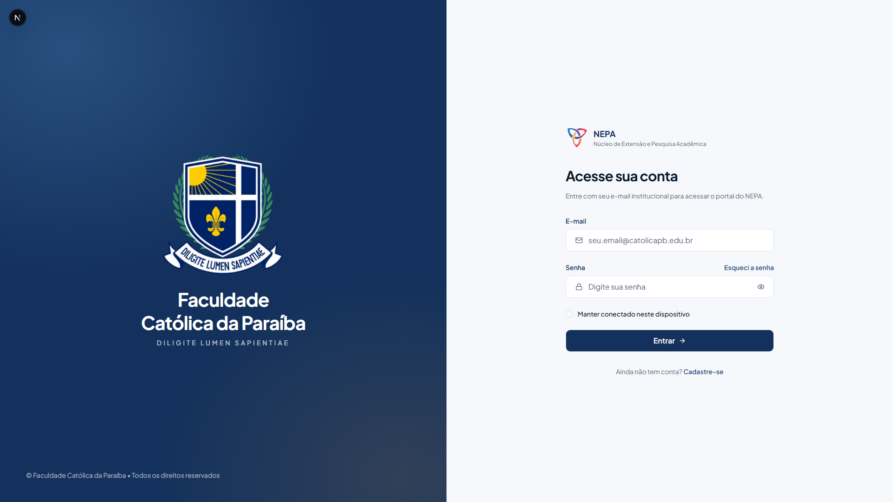

### Cadastro

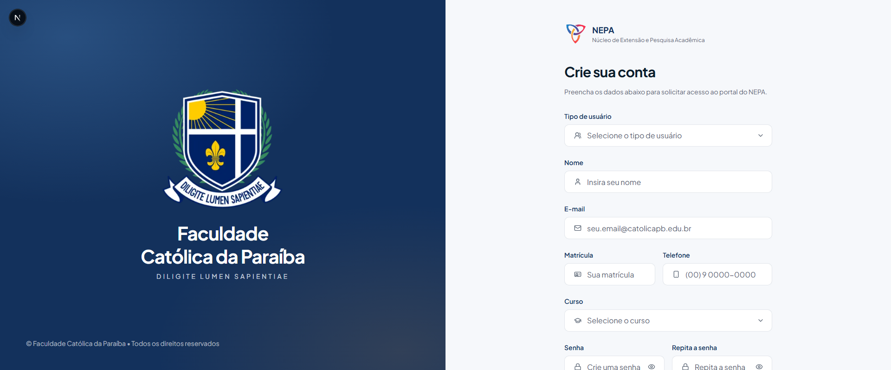

### Verificação em duas etapas

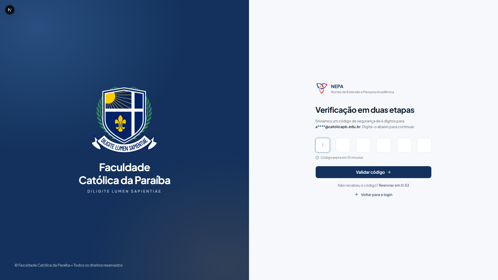

### Recuperação de senha

| 1. Informar o e-mail                            | 2. Validar o código                           |
| ----------------------------------------------- | --------------------------------------------- |
| 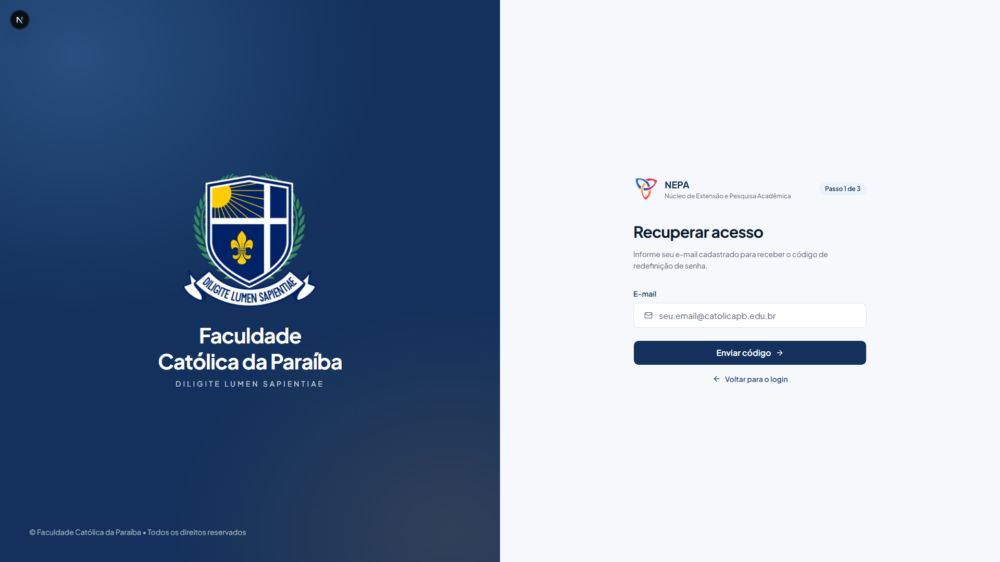 | 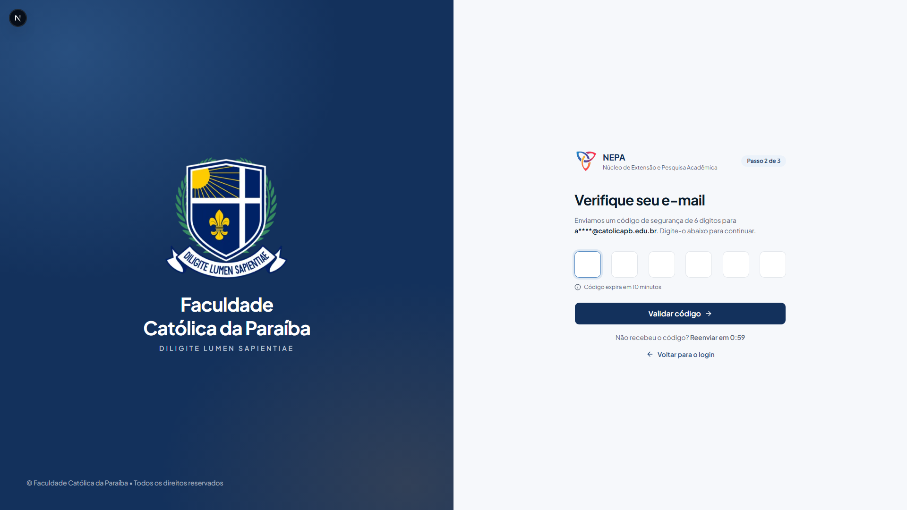 |

| 3. Nova senha (vazio)                              | 3. Nova senha (preenchido)                        |
| -------------------------------------------------- | ------------------------------------------------- |
| 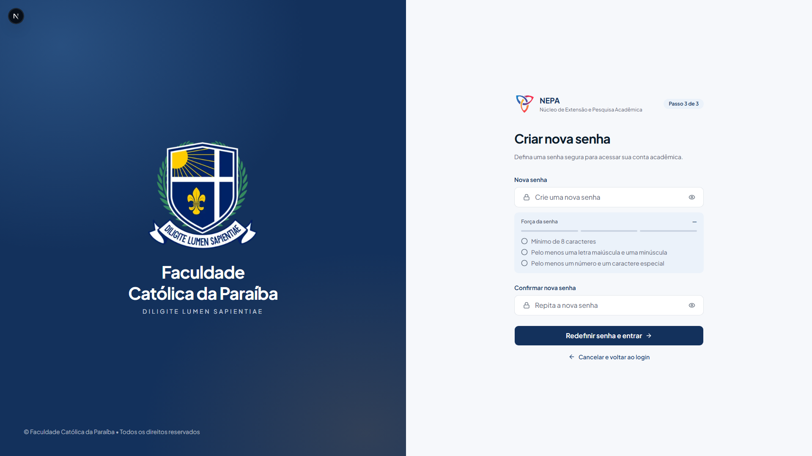 | 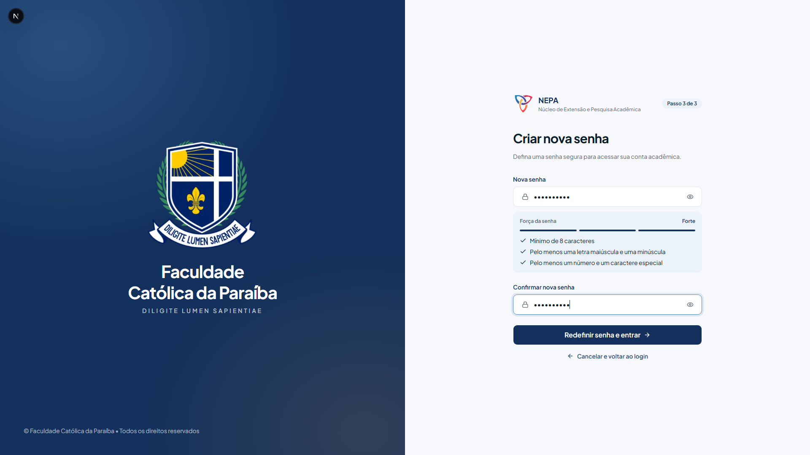 |

### Ativação de conta

| Aguardando ativação                               | Validando o link                                    |
| ------------------------------------------------- | --------------------------------------------------- |
| 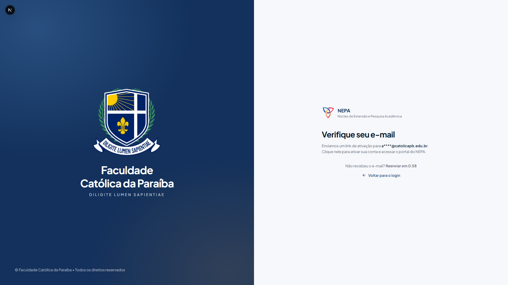 | 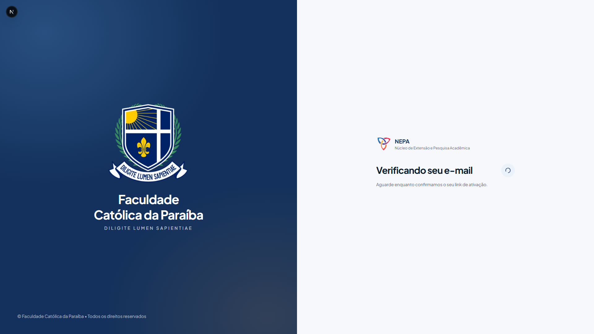 |

| Conta ativada                                 | Link expirado                                 |
| --------------------------------------------- | --------------------------------------------- |
| 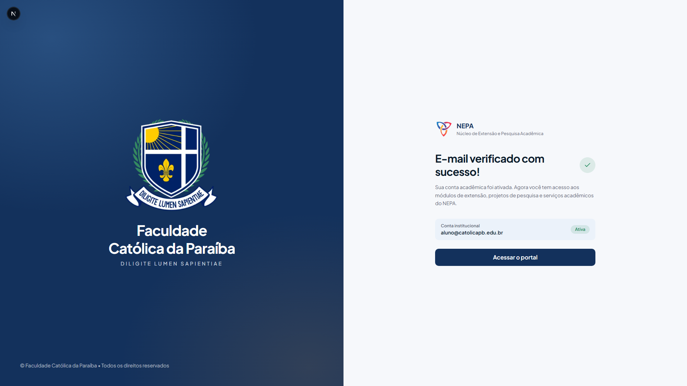 | 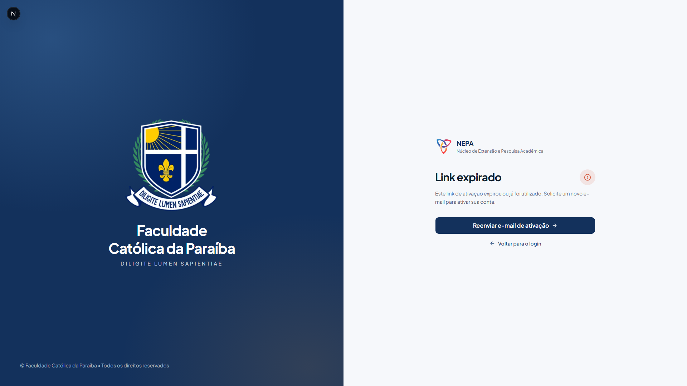 |

Para adicionar novas capturas, salve o arquivo em `images/` (de preferência `.png`, em minúsculas e com hífens) e referencie-o aqui com ``.

## Estrutura

```text
.
├── src/
│   ├── app/            # rotas (App Router) e estilos globais
│   ├── components/
│   │   ├── auth/       # blocos compartilhados das telas de autenticação
│   │   └── ui/         # componentes shadcn/ui (base-nova, sobre @base-ui/react)
│   └── lib/
│       ├── auth/       # schemas (zod), mock da API, fluxo de recuperação, formatadores
│       └── utils.ts    # cn()
├── public/             # arquivos estáticos (logos)
├── images/             # capturas de tela usadas neste README
├── Dockerfile          # imagem de produção (build em estágios, output standalone)
├── compose.yaml        # execução com Docker Compose
├── next.config.ts      # configuração do Next.js
└── .prettierrc         # configuração do Prettier
```

O guia de design está em [DESIGN.md](DESIGN.md) e as convenções de desenvolvimento em [CLAUDE.md](CLAUDE.md).
